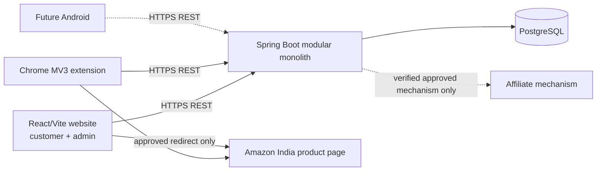
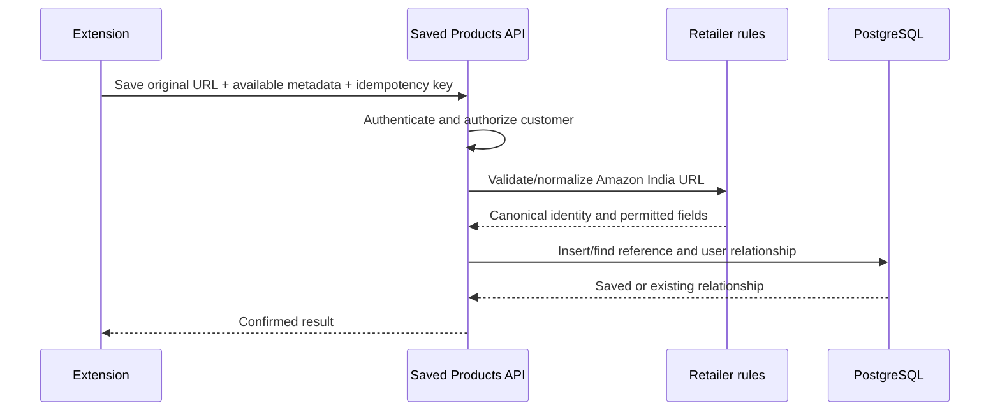
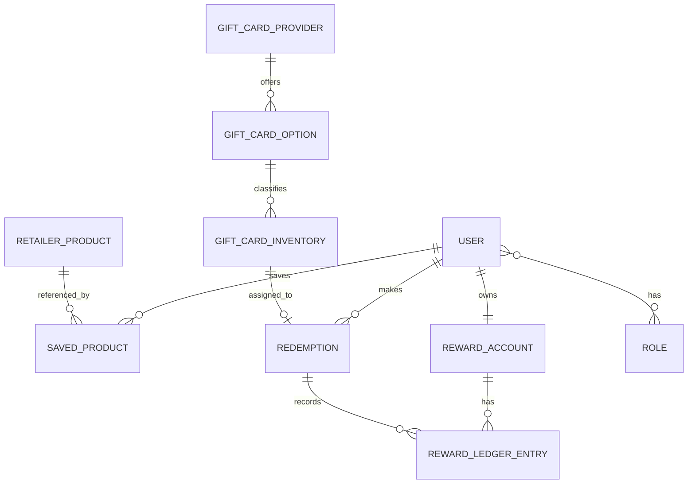

# BringMyCart 2.0 Architecture

**Status:** Approved in principle; Phase 1 backend foundation implemented. Later phases require their own approval.  
**Requirements source:** [SRS](SRS.md). This document does not lift its affiliate-policy or attribution blockers.

## 1. Architecture Overview

BringMyCart is a modular monolith: one Java 21 Spring Boot REST application, one PostgreSQL database, a React/Vite web application containing customer and admin experiences, and a Chrome Manifest V3 extension. The future Android client uses the same versioned API. This is the smallest architecture that provides strong transactional consistency for points and inventory without distributed-system overhead.



Clients render UI, collect untrusted input, and present backend results. The backend owns authentication, authorization, validation, business policies, audit events, encryption/decryption decisions, and transactions. PostgreSQL provides durable state and transactional isolation. Amazon remains external: BMC neither receives Amazon credentials nor modifies carts/checkout. Affiliate capability is separately controlled and disabled unless verified.

## 2. Modular Monolith Design

Modules communicate through application-service interfaces and domain events within one process; no module reads another module's repositories/tables directly. Each module exposes a narrow public package/API and keeps entities, repositories, and services internal. A dependency rule (and module tests) should prohibit cycles. Spring Modulith is a useful optional guardrail for module verification/event publication, but is not required for MVP; conventional packages plus tests are lower ceremony for a small team.

| Module | Responsibility, owned entities, and use cases | Dependencies / public interface | SRS |
| --- | --- | --- | --- |
| Identity & Access | Users, roles, password credentials, refresh/session records; register, login, recovery, revoke. | Provides authenticated principal and authorization checks; no business module sees credentials. | FR-001, FR-011, NFR-001/002 |
| Saved Products | Retailer reference, product snapshot, customer save relationship; save/list/remove. | Uses Identity; asks Retailer Integration to validate/normalize. | FR-003–005 |
| Retailer Integration | Supported retailer rules, URL parsing, permitted metadata extraction contract. | Called by Saved Products; no assumed scraping/API. | FR-003/004 |
| Affiliate Integration | Approved redirect/link capability and click audit. | Called by Saved Products/UI-facing application service; independently feature-gated. | FR-006 |
| Rewards | Reward account, append-only ledger, test credits, balance projection. | Uses Identity; provides eligibility/balance reservation to Gift Cards. Real issuance disabled. | FR-007, FR-009 |
| Gift Cards | Providers/options, encrypted inventory, redemptions and assigned-code retrieval. | Uses Rewards and Identity; owns allocation transaction. | FR-008/009 |
| Administration & Audit | Admin operations and immutable audit events. | Uses Identity; invokes public inventory/redemption operations. | FR-010, NFR-005 |

The Gift Cards module may call a Rewards application service in the same database transaction. Avoid a generic shared `common` domain package; share only small technical utilities and explicit contracts. This preserves independently understandable features without pretending they are deployable services.

## 3. Proposed Repository Structure

Phase 1 has created the backend foundation and top-level module markers. Create feature internals only as their approved phase requires them; do not add placeholder business types merely to complete this tree.

```text
backend/
  pom.xml
  src/main/java/.../bmc/
    identity/ {api, application, domain, infrastructure}
    savedproducts/ {api, application, domain, infrastructure}
    retailer/ ...  affiliate/ ...  rewards/ ...  giftcards/ ...  adminaudit/ ...
    shared/ {security, error, persistence}       # technical-only
  src/test/java/...
web/                       # React + Vite customer/admin app
  src/{features, routes, api, components, auth, test}
extension/                 # Manifest V3 source and tests
docs/{SRS.md, ARCHITECTURE.md}
```

Organizing only by technical layer (`controller`, `service`, `repository`) hides feature ownership and encourages cross-feature access. Organizing only by feature can obscure standard entry points. The recommended feature-first structure retains conventional internal `api/application/domain/infrastructure` layers: API adapters call application services; domain rules do not depend on web/JPA; infrastructure implements persistence/integrations.

## 4. Authentication and Authorization

### Recommendation

Use Spring Security with short-lived JWT access tokens, refresh-token/session records that can be revoked, and role-based authorization (`CUSTOMER`, `ADMIN`) enforced at endpoint and ownership-policy levels. Exact lifetimes, issuer/audience, refresh rotation, logout semantics, account recovery, and key provider are **TBD**. Select an exact Spring Boot 3.x version only after verifying current support and Java 21 compatibility; a newer major should require approval because of migration/training risk.

For the React website, prefer short-lived access tokens held only in memory and refresh/session tokens in `HttpOnly`, `Secure`, appropriately scoped `SameSite` cookies. This reduces XSS token theft relative to persistent localStorage. It requires deliberate CSRF protection for cookie-bearing requests (origin checks plus CSRF strategy) and narrow CORS allowlists. A localStorage-based access/refresh-token design is simpler to implement but is not recommended because injected script can persistently exfiltrate tokens. JWT validation checks signature, expiry, issuer, audience, intended client, and the applicable revocation/session state; signing keys rotate and remain outside source. Passwords use a modern adaptive one-way hash. Login, registration, recovery, and refresh are rate-limited; failures are generic and audited without secrets.

For the extension, do not reuse website page storage, persist web tokens in page content, or pass tokens in URLs. The recommended design is an authorization-code-style handoff using a Chrome-supported identity/launch flow where verified, a registered extension callback, a short-lived single-use code, PKCE, state and nonce, and tab-bound pending-save state. The backend must bind the authorization request to the extension client and intended callback; the extension must verify returned state before exchanging the code. An extension-specific one-time exchange opened from BMC login is a viable alternative when Chrome identity support is unsuitable, but it has the same requirements for registered callback, state binding, expiry, replay prevention, and safe code exchange. Directly sharing the website's cookie/session with the extension is not recommended: browser cookie behavior, third-party restrictions, and extension origins vary.

Before approval, verify against current Chrome/browser documentation: the supported identity/launch API and callback URI shape; extension-ID stability and production callback registration; whether Chrome permits the required cookie/redirect behavior; MV3 service-worker lifetime during the handoff; incognito/profile isolation; CSP and host-permission constraints; and Chrome Web Store policy implications. The resulting mechanism remains TBD. Never use arbitrary redirects, token-bearing query parameters, or an unverified extension origin.

```mermaid
sequenceDiagram
  participant E as Extension
  participant B as BMC Backend
  participant U as User/Login UI
  E->>E: Detect supported page; retain tab-bound save intent
  E->>B: Save request / auth check
  B-->>E: Authentication required
  E->>U: Start allowlisted login with state, nonce, PKCE
  U->>B: Authenticate user
  B-->>E: Single-use authorization code via registered callback
  E->>B: Exchange code; resume save with idempotency key
  B->>B: Validate JWT, state/session, ownership, product input
  B-->>E: Saved / duplicate / validation result
```

Logout revokes the server-side refresh/session record; short access-token expiry limits residual access. Account recovery uses one-time, expiring, rate-limited tokens. Admin access requires a backend role check on every operation. HTTPS is mandatory; XSS defenses include output encoding, CSP, dependency hygiene, and never rendering unsafe retailer content.

## 5. Saved-Product Architecture

Essential fields: retailer identifier and normalized original URL; a save relationship with customer and timestamp. Optional snapshots are ASIN, title, image URL, price, and currency—only if legally and technically permitted and actually available. Missing values remain absent, never fabricated. Validate `amazon.in` hosts, canonicalize known URL noise carefully, extract ASIN only under approved rules, and retain original URL for customer navigation. Revalidate server-side; extension detection is only a convenience.

**Recommendation:** use a retailer-product reference plus a user saved-product relationship. A shared reference contains only permitted retailer-level data: canonical/original product identity and an optional, non-user-specific metadata snapshot. It must not contain customer identifiers, saved time, private notes, customer-specific availability, reward state, click history, or any field derived from another user's activity. The relationship owns the customer ID, save time, relationship state, and all user-specific future attributes. Every customer query must begin with the authenticated user's relationship and join the shared reference only after ownership filtering; APIs must never expose other relationship IDs, save counts, owners, or activity through the shared record. This avoids duplication and enables future retailers. Trade-off: identity/normalization rules need careful design. A single per-user record is simpler but duplicates data and complicates future change. For MVP, allow a uniqueness rule on `(user, retailer, canonical product identity)` when identity is trustworthy; otherwise fall back to normalized URL and record the limitation.



List operations are user-scoped, paginated, and sorted by save time. Deletion checks ownership. A later unavailable Amazon page does not erase the saved reference. Save retries use an idempotency key and uniqueness constraints; failed saves return a recoverable error without an ambiguous success claim.

## 6. Affiliate-Link Architecture

Affiliate integration is a feature-gated adapter, separate from saved products. It accepts only a validated saved product/original URL, uses an approved link-generation method if verified, records permitted outbound-click data, presents required disclosure, and redirects only to an allowlisted Amazon destination. Do not accept arbitrary redirect targets; if link generation fails or is disabled, navigate to the validated original URL with no affiliate/reward implication.

An affiliate click is not a purchase; a purchase is not necessarily a qualifying commission; a commission is not necessarily reward-eligible. Activation needs written verification of program policies, legal/incentive permission, allowed content/branding, link method, attribution/reporting capability, and disclosure requirements. Until then FR-006 is TBD and FR-007 is blocked.

## 7. Rewards Architecture

Maintain a reward account per customer and an append-only ledger. Each entry has an immutable transaction type, signed points amount, source/reference, correlation/idempotency key, actor, timestamp, and any permitted eligibility evidence. Recommended transaction types are `TEST_CREDIT`, `AFFILIATE_EARN_PENDING`, `AFFILIATE_EARN_APPROVAL`, `AFFILIATE_EARN_REVERSAL`, `REDEMPTION_DEBIT`, and tightly controlled `ADMIN_ADJUSTMENT`; additions or corrections are new entries, never edits or deletes. Reward eligibility is a separate lifecycle on the earning source: `PENDING`, `APPROVED`, `DISQUALIFIED`, or `REVERSED`. Pending or disqualified earning entries never contribute to available balance; reversal entries compensate previously approved value without rewriting history.

Model balances as a transactionally maintained projection derived from ledger entries, with periodic reconciliation against the ledger. Available balance equals approved, non-reversed credits (including explicitly marked test credits) minus committed redemption debits and any approved reservation/hard-hold mechanism if one is introduced; it excludes pending earnings. Store the projection with a version and update it in the same transaction as the ledger entry. Pure ledger derivation is simpler conceptually but can be costly and makes availability locking awkward; a projection is appropriate if repairable from the immutable ledger and never treated as a source of truth independent of it.

Reward issuance is independently feature-flagged off. Controlled test balances are explicit non-commercial `TEST_CREDIT` entries restricted to authorized test/admin processes, clearly labeled, and never treated as affiliate earnings. Future real issuance needs a verified external source identifier, duplicate-event key, eligibility and settlement evidence, reversible lifecycle, and reconciliation. `AFFILIATE_EARN_*` transaction types remain disabled until Amazon Associates India policy permission and reliable, authorized customer-level attribution are verified. Do not create a conversion rate until approved.

## 8. Gift-Card Inventory Architecture

Model provider, redemption option/denomination, and inventory item separately. An inventory item has an opaque ID, status (`AVAILABLE`, `RESERVED`, `ASSIGNED`, `DISABLED` subject to final approval), encrypted code/ciphertext metadata, expiry/validity, assignment reference, and audit trail. General listings expose status/counts only, never code material.

Use authenticated encryption such as AES-GCM with a random data-encryption key or approved envelope-encryption approach; store/manage master keys outside source and database access paths. Exact key-management service is TBD. Store a keyed fingerprint (for example, HMAC under a separately managed secret) for duplicate detection without plaintext comparison. Decryption is a narrowly scoped operation: rightful owner retrieves their assigned code after authentication/ownership validation; operationally necessary administrators require explicit elevated authorization and audit. Never log code, plaintext, fingerprint secret, or decrypted response. Assignment means BMC allocated a code, not that the provider redeemed it.

## 9. Gift-Card Redemption Architecture

Use one PostgreSQL transaction for the redemption request: authenticate; validate an opaque client idempotency key and canonical request payload; evaluate configured rules; lock/check reward balance; atomically select/lock one `AVAILABLE` matching item; create redemption; post ledger debit; mark inventory assigned; record audit; commit. The idempotency record/result is committed in that same transaction. Enforce a database uniqueness constraint on `(customer_id, operation_type, idempotency_key)` and persist a request-payload fingerprint. Reuse of a key with a different option, amount, or other material payload must be rejected rather than replayed against a different request. Concurrent duplicates either wait for the first request's idempotency record to resolve or receive a retryable in-progress outcome; neither starts a second allocation.

PostgreSQL row-level locking is the practical primary strategy. Combine it with unique constraints (one inventory item per redemption; unique customer/operation/idempotency key) and optimistic versioning for ordinary admin edits. Pessimistic locking is warranted for scarce monetary-value inventory; it avoids two users receiving the last code. Configure a bounded lock/statement timeout. A lock timeout or serialization/deadlock abort is a non-success result: the transaction rolls back completely, returns no assigned code, and may be retried with the same idempotency key after the client observes a retryable error. Timeout values and HTTP error mapping remain TBD.

If two users request the final item, one transaction locks and assigns it; the other waits only to the configured bound, then either observes no available inventory or receives a retryable lock-contention result. In both cases it has no debit or assignment. Any pre-commit validation, lock, persistence, or rule failure rolls back the idempotency, reward projection, ledger, inventory, redemption, and audit changes together. If the server commits but the response is lost, a retry with the same key and matching payload retrieves the committed redemption/result rather than allocating/debiting again. Post-commit display failure leaves the redemption assigned and retrievable through the owner-only endpoint; it must not refund/reassign automatically.

```mermaid
sequenceDiagram
  participant C as Customer
  participant B as Gift Cards API
  participant D as PostgreSQL
  C->>B: Redeem option + idempotency key
  B->>D: Begin transaction; lock idempotency/reward/inventory rows
  D-->>B: Approved balance + one AVAILABLE code, or none
  B->>D: Ledger debit + redemption + ASSIGNED inventory + audit
  B->>D: Commit
  B-->>C: Redemption confirmation (no code in general response)
  C->>B: Owner-only assigned-code retrieval
  B-->>C: Secure code after ownership check
```

The points conversion and redemption rules remain TBD; no redemption proceeds without a configured approved rule. Consider `SKIP LOCKED` only after testing fairness/availability behavior; ordinary `FOR UPDATE` is easier to reason about for initial low volume.

## 10. Database Architecture

| Entity | Purpose / key constraints / sensitivity | Owner |
| --- | --- | --- |
| User, Role, UserRole | Account and RBAC; unique normalized email; credential data isolated. | Identity |
| AuthSession/RefreshToken | Revocable, hashed refresh/session references; expiry and device metadata. | Identity |
| RetailerProduct | Retailer, canonical/original URL, optional ASIN/snapshot; unique retailer+canonical identity where reliable. | Saved Products |
| SavedProduct | User-to-product save; unique user+product/identity; index user+saved time. | Saved Products |
| RewardAccount | Per-user transactionally consistent available-balance projection/version; rebuildable from ledger. | Rewards |
| RewardLedgerEntry | Immutable transaction type, signed amount, eligibility lifecycle, source/reference, correlation/idempotency and external dedupe keys; no rewrites. | Rewards |
| GiftCardProvider/Option | Provider and configured denomination/rule reference. | Gift Cards |
| GiftCardInventory | Encrypted code, keyed fingerprint, status, expiry, assignment; unique fingerprint; never return code in lists. | Gift Cards |
| Redemption | Customer, option, inventory, ledger/idempotency reference, request-payload fingerprint, state; unique inventory and customer+operation+idempotency key. | Gift Cards |
| AuditEvent | Actor/action/object/time/correlation; no secret values. | Administration & Audit |



Indexes support user product listing, ledger/history ordering, available inventory by option/status/expiry, and audit lookup. Foreign keys and unique constraints complement—not replace—transaction locking. The redemption transaction modifies the account projection, ledger, inventory, redemption, and audit record together.

## 11. REST API Architecture (Proposed)

Use `/api/v1`, JSON, standard status codes, correlation IDs, and one stable error shape (`code`, `message`, `fieldErrors`, `traceId`) that never leaks secrets. These are conceptual contracts pending review, not an implementation specification.

| Group | Method / path | Purpose; auth/role; key rules | SRS |
| --- | --- | --- | --- |
| Auth | `POST /auth/register`, `/auth/login`, `/auth/refresh`, `/auth/logout`; `GET /me` | Public except current/logout; rate limit and secure cookie/extension flows. | FR-001/011 |
| Saved products | `GET/POST /saved-products`, `DELETE /saved-products/{id}` | Customer; POST idempotency key, server URL validation; all objects owner-scoped. | FR-003–005 |
| Navigation | `POST /saved-products/{id}/open` | Customer; allowlisted original/approved link; no purchase claim. | FR-006 |
| Rewards | `GET /rewards/balance`, `GET /rewards/ledger` | Customer; read-only history. | FR-007 |
| Redemption | `GET /redemption-options`, `POST /redemptions`, `GET /redemptions`, `GET /redemptions/{id}/code` | Customer; POST idempotency key; code endpoint narrowly owner-authorized/no cache. | FR-009 |
| Admin | `POST/GET /admin/gift-card-inventory`, `GET /admin/redemptions` | Admin; validate upload, mask code, audit every mutation. | FR-008/010 |

Authorization belongs in both route policy and application ownership checks to prevent IDOR. API versioning permits future Android clients without client-specific business rules.

## 12. React Frontend Architecture

One Vite React application hosts customer routes (login, dashboard, saved products, rewards, redemptions, assigned-code view, installation help) and protected `/admin` routes (inventory, redemption monitoring). Use feature folders, a thin API client, server-state fetching/caching library only if it reduces repetitive loading/error/retry logic, and local React state/context for small UI/auth state. A large global state library is not justified initially.

Use route guards for user experience, but rely on backend authorization. Forms require client validation plus accessible server-error rendering. Provide loading, empty, network-error, and retry states; responsive semantic UI; keyboard navigation; and an accessibility target TBD in the SRS. Assigned codes should be fetched only on explicit view, never persisted, cached broadly, copied to telemetry, or displayed in lists.

## 13. Chrome Extension Architecture

MV3 components: popup renders supported/unsupported, authentication, and save states; a content script minimally reads the current supported product page/URL under limited Amazon host permissions; service worker coordinates popup/content/backend messaging and tab-bound auth/save intent. The backend remains authority for product validation and identity. Use only required Amazon India host patterns and BMC API/connect permissions; avoid broad host permissions and never inject Amazon credentials or alter page/cart behavior.

The public website supplies installation guidance and, once published, the official Chrome Web Store listing URL; that URL remains TBD. Test popup/content/service-worker boundaries, message origin/schema validation, unsupported pages, expiry, and handoff replay/failure.

## 14. Security Architecture

Primary assets are accounts, JWT/session material, personal saved collections, reward balances, and gift-card codes. Enforce HTTPS, adaptive password hashing, short-lived signed JWTs, refresh revocation/rotation design, key rotation, RBAC, ownership checks, input validation, parameterized JPA queries, strict CORS, CSRF protection for cookie-authenticated routes, CSP/XSS protection, secret manager use, encrypted codes, and masked structured logs. Rate-limit auth/recovery/redemption attempts as appropriate. Scan dependencies and promptly assess security updates. Audit authentication-sensitive admin/inventory/redemption events without codes/tokens. Treat extension messages, retailer page data, URLs, and all client input as hostile.

## 15. Testing Strategy

Use JUnit 5/Mockito for domain/application rules; Spring Boot integration tests for security, REST adapters, JPA mappings, and transaction boundaries; Testcontainers PostgreSQL for repository and lock/constraint behavior. Explicitly test ownership, unauthorized admin access, duplicate saves, code masking, idempotency, rollback, two concurrent final-inventory redemptions, and lost-response retry. React tests cover components/forms/errors/protected navigation, plus critical API-backed flows. Extension tests cover page detection, unsupported page, messaging, auth handoff, and save outcomes. End-to-end tests cover the customer save journey and controlled-test redemption only. No test may assume real affiliate attribution.

## 16. Deployment Architecture

Deploy the monolith as one stateless Spring Boot service and PostgreSQL as managed or self-managed infrastructure selected later; serve the static React build through an approved HTTPS-capable hosting layer. Distribute the extension through Chrome Web Store after review. Separate local, test, staging, and production environments; inject configuration/secrets via environment/secret management, never source. Use approved schema migrations, connection pooling, structured masked logs, health/readiness checks, monitoring/alerts, encrypted backups, restore drills, and least-privilege database roles. CI/CD and cloud provider remain TBD; local development may use ephemeral/test containers while production requires backup and operational ownership.

## 17. Future Extensibility

Retailer Integration uses retailer-specific adapters behind a stable validation/normalization contract, but only Amazon India is implemented for MVP. The REST API is client-neutral for Android. Affiliate providers remain adapters behind a verified capability. Automated gift-card procurement can later feed the same inventory boundary. Do not add abstractions or infrastructure until a second concrete use case validates them.

## 18. Decisions and Trade-offs

| Decision | Recommendation | Alternatives | Rationale / trade-off | Status |
| --- | --- | --- | --- | --- |
| Runtime | Java 21, Spring Boot exact version TBD | Older Java / newer major Boot | Approved stack; verify current supported Boot 3.x first. | Confirmed / version TBD |
| Architecture | Modular monolith | Microservices | Strong transactions and lower ops burden; less independent scaling. | Confirmed |
| Persistence | PostgreSQL + JPA/Hibernate | NoSQL / direct SQL only | Relational constraints and transactions suit assets/ledger; JPA discipline needed. | Confirmed |
| Web | React + Vite | Other SPA tooling | Approved, lightweight tooling. | Confirmed |
| Auth | JWT access + revocable refresh/session design | Long-lived JWT/localStorage | Better logout/revocation/XSS posture; more server state. | Recommended; details TBD |
| Redemption | One transaction + row locks + idempotency | Eventual consistency/queue | Correctness for monetary assets; lock contention at high scale. | Recommended |
| Product model | Shared retailer reference + saved relationship | Per-user snapshot only | Reduces duplication/future ready; normalization complexity. | Recommended |
| Affiliate rewards | Disabled until proof | Infer clicks as purchases | Preserves compliance and integrity; delays monetization. | Blocked |

## 19. Requirement Traceability

| Architecture area | Requirements |
| --- | --- |
| Identity/JWT/extension handoff | FR-001, FR-011, NFR-001/002/009 |
| Saved Products/Retailer adapter | FR-003–005, NFR-004/006/007 |
| Affiliate capability gate | FR-006, FR-007, NFR-001/005 |
| Rewards ledger | FR-007, FR-009, NFR-003–005/007 |
| Gift-card inventory/redemption | FR-008–010, NFR-001–005/007 |
| React/extension clients | FR-002–005, FR-009–011, NFR-008/009 |

Clarification is still required for Spring Boot version, auth/extension callback details, metadata permission/method, points and redemption rules, operational targets, privacy retention, and all affiliate permissions/attribution.

## 20. Proposed Implementation Roadmap

| Phase | Goal and deliverables | Dependencies / SRS | Testing and completion criteria |
| --- | --- | --- |
| 1 | Repository conventions, Maven backend foundation, approved version selection. | Architecture approval; NFR-006/007 | Build, formatting, basic integration test baseline. |
| 2 | Identity, JWT/refresh/revocation design, RBAC. | Auth decisions; FR-001 | Auth, rate-limit, authorization tests pass. |
| 3 | Amazon URL validation and saved-product backend. | Metadata rules; FR-003–005 | Validation, duplicate, ownership, retry tests pass. |
| 4 | React customer dashboard. | Phase 2–3; FR-002/005 | Accessible loading/error and customer-flow tests pass. |
| 5 | MV3 extension and secure handoff. | Approved Chrome/auth callback; FR-003/004/011 | Detection, handoff, save-flow tests pass. |
| 6 | Admin RBAC and encrypted gift-card inventory. | Key management approval; FR-008/010 | Masking, audit, authorization tests pass. |
| 7 | Ledger and controlled test balances/redemption rules. | Approved test policy; FR-007/009 | Ledger/reconciliation and test-only separation pass. |
| 8 | Atomic redemption and security hardening. | Phase 6–7; FR-009, NFR-001–005 | Concurrency, idempotency, rollback, recovery tests pass. |
| 9 | Approved affiliate integration only after verification. | Resolved FR-006/007 blockers | Policy, attribution, disclosure, integration evidence approved. |
| 10 | Production readiness/deployment. | Operational decisions; NFR-010 | Backups, monitoring, security review, staging acceptance complete. |

This roadmap is planning only and grants no implementation authorization.

## 21. Phase 1 Implementation Status

**Implemented:** Java 21, Spring Boot 3.5.6, Maven Wrapper, PostgreSQL development connectivity through externally supplied credentials, Spring Data JPA/Hibernate with non-mutating schema management, Actuator health exposure, JUnit 5, Testcontainers PostgreSQL integration testing, and module boundary markers. No domain entities, migrations, controllers, authentication, JWT handling, frontend, extension, saved-product, affiliate, rewards, or gift-card behavior has been implemented.

**Developer-verified results:** `mvnw.cmd clean verify` completed successfully with two passing tests and produced an executable JAR. The application started with the `dev` profile on port 8080, and `/actuator/health` returned HTTP 200. The developer-reported health response body was not captured in this documentation, so this does not claim a database-specific health detail.

**Phase 1 compatibility notes:** Docker Engine 29 requires API 1.44 or newer. The verified temporary JVM workaround is `-Dapi.version=1.44`; the maintainable recommendation is to pass that value only to the Maven Surefire test JVM, after confirming it remains effective with the selected Testcontainers version. A Windows/JDBC timezone failure occurred when the JVM supplied `Asia/Calcutta`; `-Duser.timezone=Asia/Kolkata` is a verified local-run workaround, not a universal deployment setting. Phase 2 remains unimplemented and subject to the identity decisions in this document.
